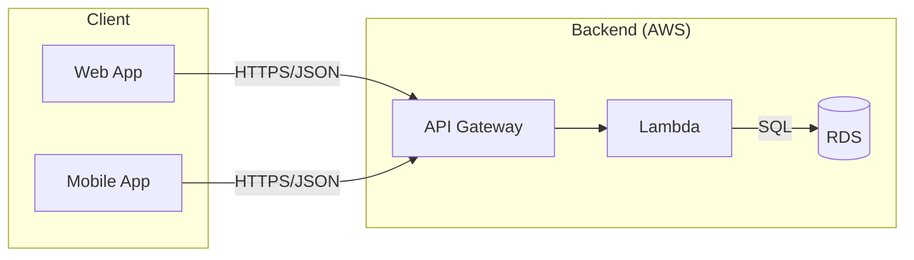
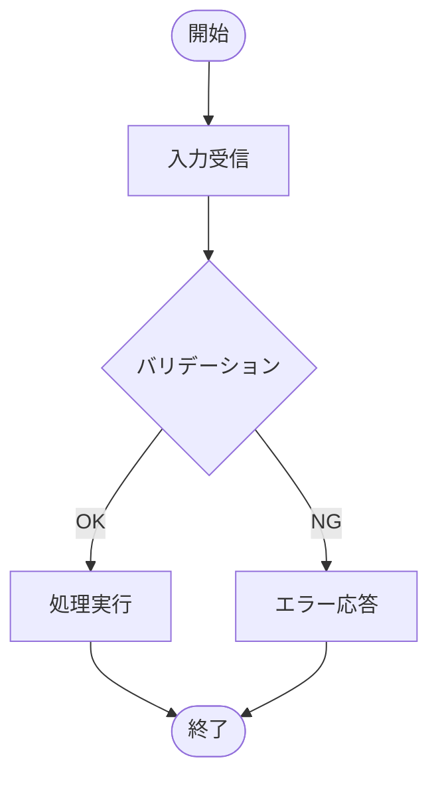
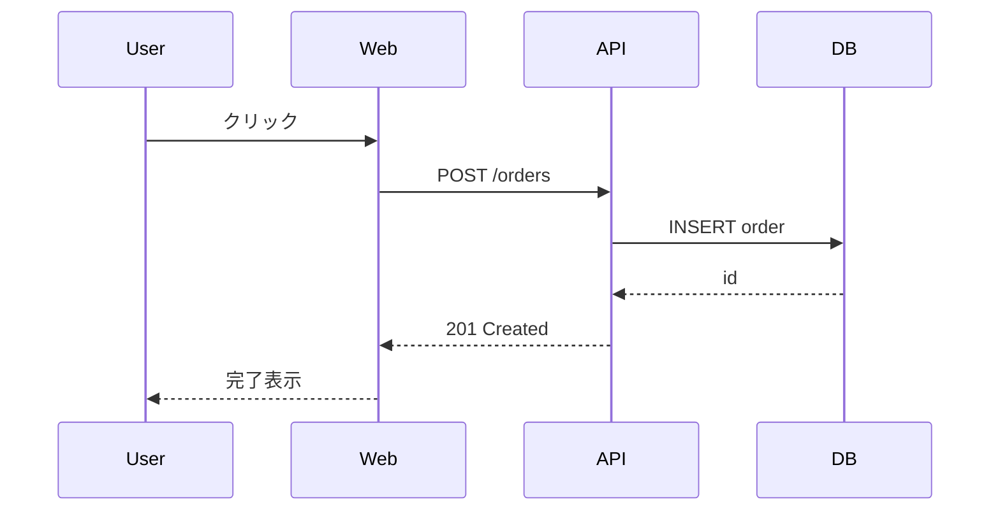
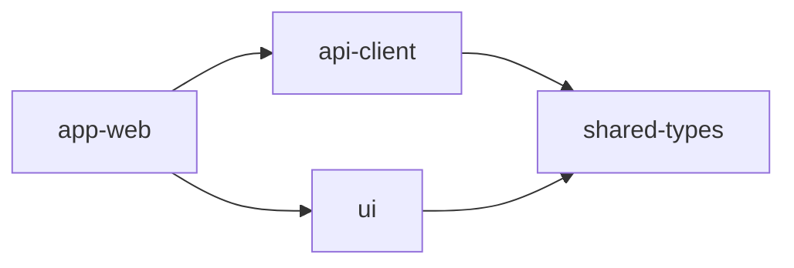
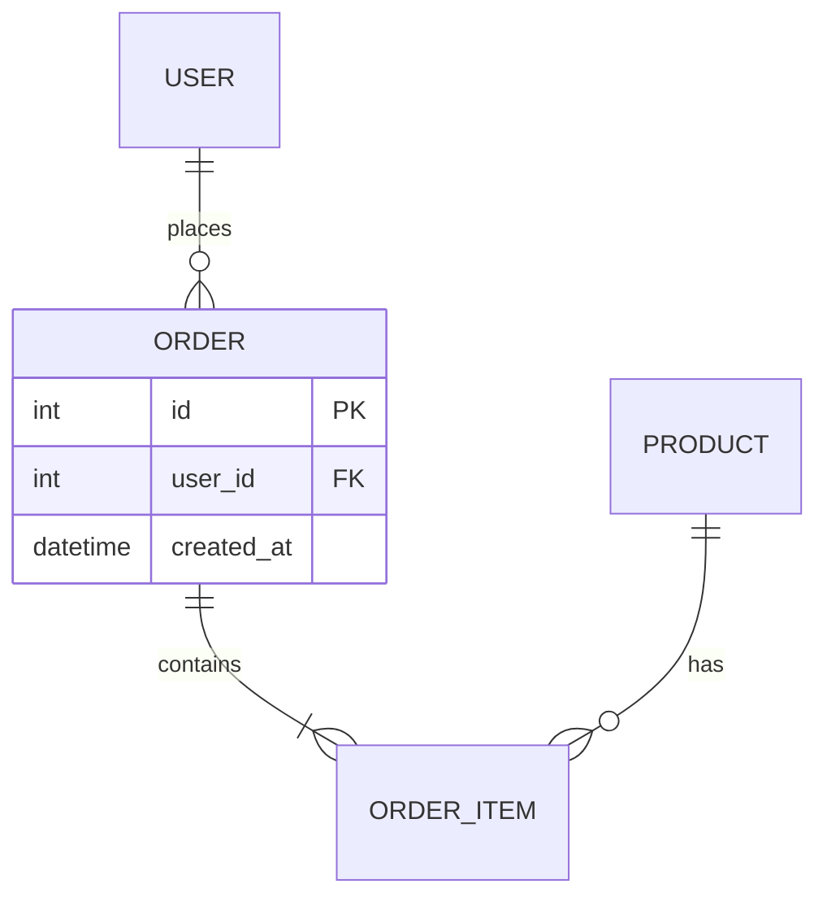
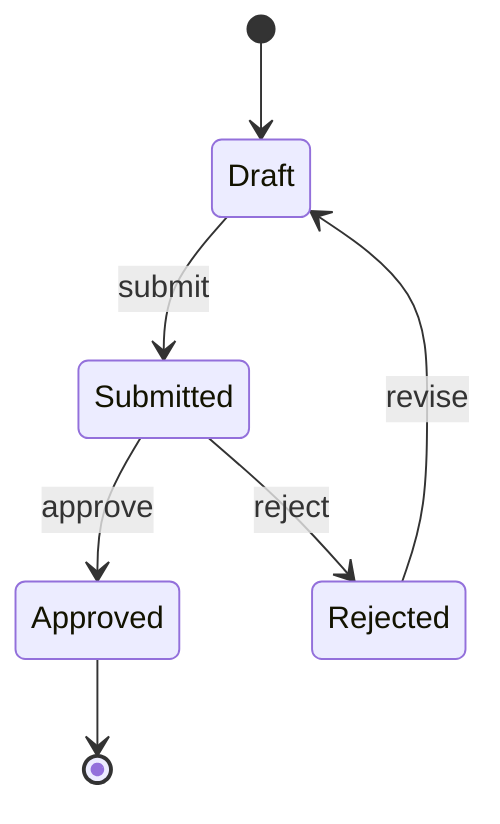

# 図種別のテンプレートと書き方

目次:

- アーキテクチャ図 / システム構成図
- フローチャート
- シーケンス図
- 依存関係図
- ER 図
- 状態遷移図
- クラス図

## アーキテクチャ図 / システム構成図

`graph LR` + `subgraph`。C4 model の Context（システム境界）/ Container（デプロイ単位）/ Component（内部構造）を 1 枚に混ぜず、1 枚 1 レベルにする。

- ノードラベルは「名前 + 役割 + 技術」（`Order API [Node.js/Fastify]`）。クラス名や「business logic」のような曖昧語は書かない
- エッジラベルは「目的 + プロトコル」（`Reads orders [HTTPS/JSON]`）
- subgraph で区切るなら、何の境界（レイヤー、VPC、Region）かを明記する
- 1 枚 7±2 ノードを基本に、container 図でも 15 まで。超えたら抽象レベルを上げるか分割する

## フローチャート

- 判断分岐は縦に読むので `TD`。横長のパイプラインだけ `LR`
- シェイプの意味を固定する: `([...])` 開始・終了、`[...]` 処理、`{...}` 判断、`[/.../]` 入出力
- 判断ノードの出口は 2 本以上にし、すべてに条件ラベル（Yes/No、OK/NG）を付ける
- 20 ノードを超えたら subgraph か別図に分ける
- ループ・並行・長い時系列を表したくなったら、シーケンス図か状態遷移図に切り替える

## シーケンス図

- lifeline は 6 本まで。超えたらユースケースごとに分ける
- 矢印ラベルはメソッド名と主要引数（`createOrder(userId, items)`）。戻り値は破線 `-->>` で書く
- 条件分岐や繰り返しは `alt` / `opt` / `loop` / `par` で表す
- 正常系だけでなく、timeout・4xx・バリデーション失敗などのエラーパスを少なくとも 1 本入れる

## 依存関係図

- `node_modules`・テスト・生成物は除き、深さは 3〜4 までにする
- 矢印は上位レイヤーから下位レイヤーへの向きにそろえる。逆向きは循環依存の兆候なので色で目立たせる
- ノードにはパッケージ名だけを書く
- 色の軸は 1 つ（レイヤーかチーム所有のどちらか）にする

## ER 図

- Crow's foot 記法で、optionality（`o` / `|`）も書く
- PK / FK を明示し、属性は主要なものだけにする
- M:N は中間エンティティ（`ORDER_ITEM`）で解決する
- 20 テーブルを超えたらドメインごとに分ける

## 状態遷移図

- 遷移ラベルは `event [guard] / action` の形にそろえる
- 同じ状態から出る guard は互いに排他にし、漏れは `[else]` で塞ぐ
- 出口の無い状態と入口の無い状態を残さない
- 状態が 8 を超えたら composite state で階層化する

## クラス図

`classDiagram` で書く。

- 概念・設計・実装の視点を 1 枚に混ぜない
- 可視性（`+ - # ~`）と多重度（`0..1`、`1..*`）を書く
- composition `*--`、aggregation `o--`、dependency `..>` を区別する
- 1 枚 10 クラス、継承は 3 階層までにする
